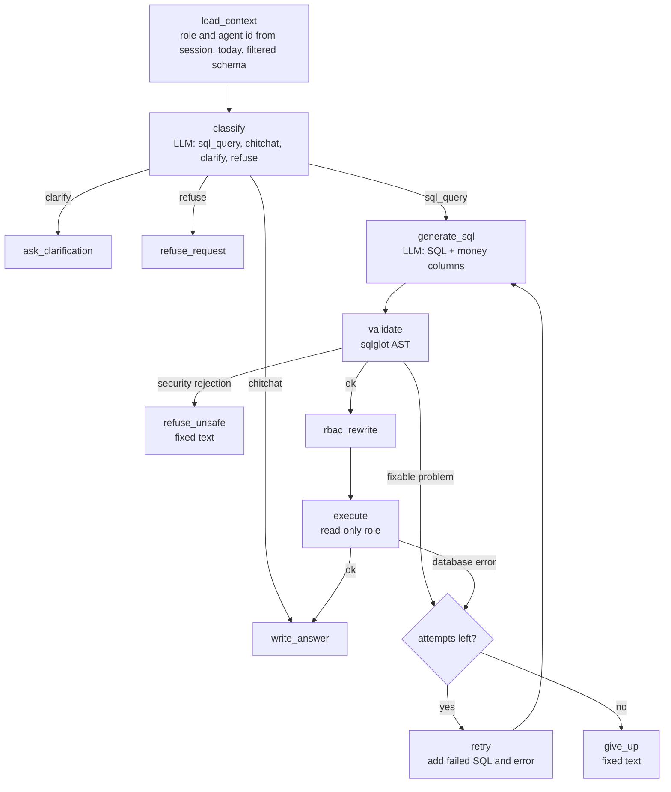

# Architecture

## Overview

```
Browser -> Streamlit UI (8501) -> FastAPI (8000) -> LangGraph -> Postgres (Supabase)
                                                       |
                                                       +-> Anthropic API
```

The UI only calls the API. The API holds the sessions, the graph and all database access. Only the UI is public. In Docker the API is reachable only inside the compose network.
## LLM flow

The LLM decides what the user wants. Code never routes by matching words in the question.



`classify` also rewrites a follow-up ("Bagaimana dengan Siti Rahma?") into a standalone question using the last 6 turns, and lists the tables it expects to need. `write_answer` receives rows that Python has already formatted (for example `Rp 1.554.000.000`), so the model copies numbers and never computes them. All arithmetic happens in SQL.

### Retry loop

If the validator finds a fixable problem (unknown column, a function outside the allowlist, `CURRENT_DATE` instead of the literal date) or the database returns an error, the failed SQL and the error message go back to `generate_sql`. The limit is `MAX_RETRIES = 2`, so a question gets at most 3 attempts. After that the graph ends in `give_up`.

A security rejection is never retried. It goes straight to `refuse_unsafe`.

## Defense against injection

The defense has several independent layers. Each one still holds if the one before it fails.

1. **Role-filtered schema.** The prompts only list the tables and columns the user's role may use. `system_users` is never listed. The role comes from the server session, not from the question.
2. **Prompt hygiene.** User text and query results are wrapped in `<question>` and `<query_result>` tags and treated as data. Angle brackets in user text are escaped so the user cannot close a tag.
3. **AST validation (`app/sql/validator.py`).** `sqlglot` parses the SQL. It must be exactly one SELECT. Any write node is rejected (INSERT, UPDATE, DELETE, DROP, ALTER, CREATE, TRUNCATE, MERGE, COPY, SELECT INTO, locking clauses), including inside a CTE or subquery. Tables and columns outside the role's allowlist are rejected. A CTE named like a real table is rejected. Functions must be on an allowlist. There is no regex and no `contains` check anywhere in this step.
4. **RBAC rewrite (`app/sql/rbac.py`).** After validation, every restricted table in the AST is replaced by a subquery that selects only the allowed columns and filters the rows. For Sales: `sales_contracts` by `salesagentid`, and the child tables by the contracts that agent owns. The agent id comes from the session. This works the same for joins, CTEs, subqueries and unions, and it cannot be widened by the user's own WHERE clause.
5. **Database role.** Generated queries run as `app_readonly`: SELECT on the five business tables only, read-only transactions, a 10 second statement timeout. The executor reads at most 200 rows. The user list uses a different role, `app_auth`, that can read only `system_users`. Both roles are revoked from the Supabase `anon` and `authenticated` roles (`db/roles_pg.sql`).

Row level security on the Supabase project is an extra net for direct access through Supabase's own API. The application does not depend on it.

### Fixed text written by code

The answer text is written by the LLM except in three cases, where code returns a fixed Indonesian message:

1. The validator rejects the SQL for security reasons.
2. A Sales user gets an empty result.
3. The graph gives up after 3 attempts.

These cases are triggered by the validator or by the execution result, never by matching the question text. So input from an attacker cannot change the content of the refusal. The refusal also cannot leak the schema or the reason, because it does not contain them.

When the result is empty for a Sales user, the API returns this fixed text:

> Tidak ditemukan data yang sesuai dalam data yang dapat Anda akses.

The text is neutral on purpose. The query ran with the row filter applied, so an empty result means either the data does not exist or it belongs to another agent. A more specific answer, such as saying the customer does not exist or has no penalties, would reveal which case applies or would be a false claim about data the user cannot see.

## Known limit: aggregates for Sales

This limit is not mitigated in code.

The RBAC rewrite filters rows before the query logic runs. An aggregate query over rows the Sales user cannot see still returns one row. For example `SELECT COUNT(*) FROM late_fee_penalties WHERE contractid = <another agent's contract>` returns `0`, not an empty result. The neutral text above is only used when there are no rows, so this `0` reaches the answer. The user could read it as "this customer has no penalties", which may be false.

No data of another agent is revealed, only a wrong zero. The prompts deliberately contain no rule that pushes the model towards aggregates for yes/no questions, because that would make this worse. Detail queries return no rows and get the neutral text. The gap could be closed in code by inspecting the AST and rejecting aggregate-only queries for scoped roles. That check does not exist yet.

## Other decisions

**No login.** The brief asks for a user switcher, so the UI shows a dropdown filled from `System_Users`. Choosing a user calls `/sessions`, which creates a random UUID. The server keeps the user under that id and the identity always comes from there. Nothing is signed. Anyone who can open the demo can pick any user, which is what the brief asks for. The design suits a demo and is not suitable for real data. Switching user starts a new session with empty history, so one role's data never leaks into another.

**In-memory sessions.** `SessionStore` keeps the last 6 turns per session. It limits a session to 50 messages and the store to 500 sessions (least recently used is dropped). Sessions are lost on restart, and the UI then opens a new session for the same user. Because of this the API runs as a single process. Question length is limited to 500 characters. There is no other rate limit, and a new session can be created without limit.

**Streamlit XSRF and CORS are off** (`.streamlit/config.toml`). Behind a reverse proxy the browser's Origin does not match the address Streamlit sees, so with the defaults the websocket is rejected with 403. Streamlit requires both options to be off together. The risk is low here because the app has no file upload and no login cookie that an attacker could abuse, and the UI holds no secrets. The setting would not be safe for an app with real logins.

**`except Exception` in `/chat`.** Any unexpected failure becomes a generic 500 with a fixed message. The log records only the exception type, because driver messages can contain the connection string. With `APP_ENV=development` the log also holds the full traceback. The client never receives a traceback. The catch is broad so that one failed request cannot leak details. The cost is that production logs show less than a debugger would need.

**`/docs`, `/redoc` and `/openapi.json`** exist only when `APP_ENV=development`.

## Logging

Every graph node writes one JSON line to stdout with the request id, session id, node name, duration and a short result. Each request ends with one `request_summary` line: total, LLM and database time, LLM calls, SQL attempts, intent, outcome and tokens. Logs never contain keys, passwords, connection strings or result rows (only the row count). The SQL after the RBAC rewrite goes to the server log only. The `steps` sent to the UI never include SQL text.
